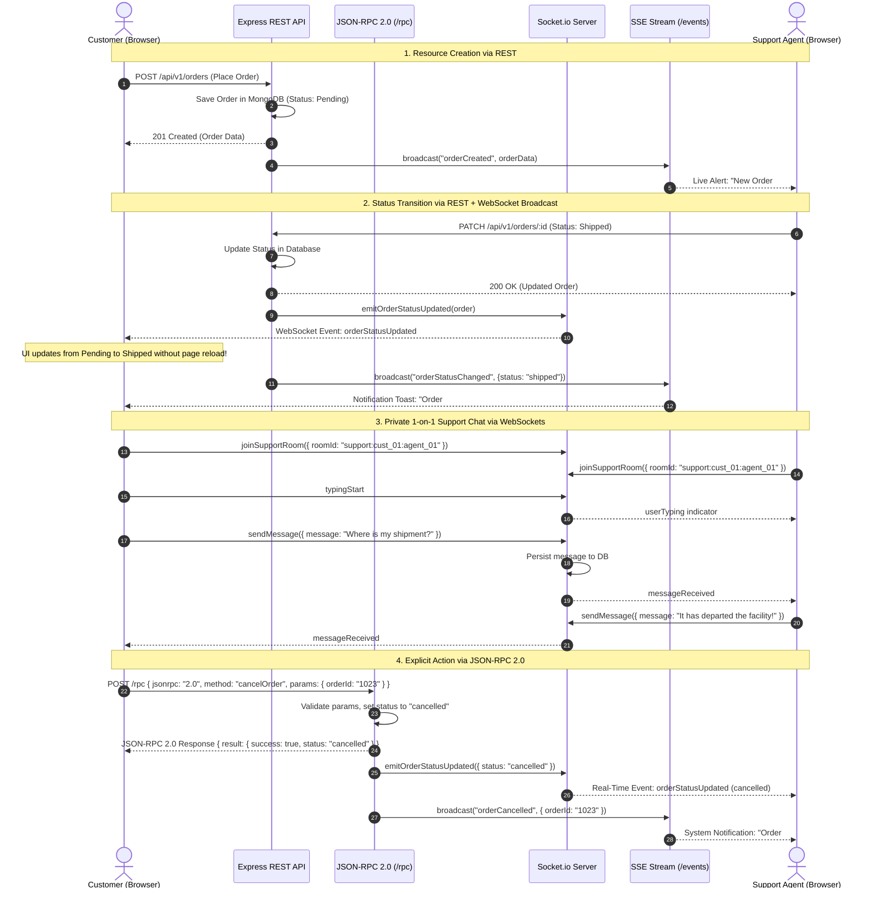

# Real-Time Order Tracker & Live Support System

**Lab Assignment 04 — Advanced Web Engineering & Distributed Communication Protocols**

A complete, production-ready full-stack web application demonstrating the unified integration of **four fundamental distributed communication protocols** within a single architecture:

1. **REST API** (Express.js `/api/v1`) — Standard resource CRUD operations for products, orders, and dashboard statistics.
2. **WebSockets** (Socket.io) — Bi-directional, event-driven real-time communication for live order status synchronization and private 1-on-1 customer-to-agent support chats with typing indicators.
3. **JSON-RPC 2.0** (`POST /rpc`) — Strictly compliant JSON-RPC 2.0 remote procedure call endpoint for explicit business actions (e.g. `cancelOrder`, `getOrderStatus`, `assignSupportAgent`).
4. **Server-Sent Events (SSE)** (`GET /events`) — Unidirectional, persistent push stream for global broadcast system notifications and alert feeds.

---

## Architecture & Protocol Flow

The system is designed so that the communication protocols operate cooperatively rather than in isolation.

```mermaid
flowchart TD
    subgraph Client["Frontend (React + Vite + Tailwind CSS)"]
        UI_Customer["Customer Portal"]
        UI_Agent["Support Agent Portal"]
        UI_Inspector["Multi-Protocol Inspector"]
    end

    subgraph Protocols["Communication Layers"]
        REST_P["REST API (HTTP/1.1)"]
        WS_P["WebSockets (Socket.io)"]
        RPC_P["JSON-RPC 2.0 (POST /rpc)"]
        SSE_P["Server-Sent Events (GET /events)"]
    end

    subgraph Backend["Backend Server (Node.js + Express)"]
        Router["Express REST Router (/api/v1)"]
        RPCHandler["JSON-RPC 2.0 Engine"]
        SocketEngine["Socket.io WebSocket Server"]
        SSEEngine["SSE Connection Manager"]
        DB[(MongoDB / Mongoose)]
    end

    UI_Customer -->|POST /orders, GET /products| REST_P
    UI_Customer -->|cancelOrder action| RPC_P
    UI_Customer <-->|1-on-1 Chat, Live Order Sync| WS_P
    UI_Customer <--|Live Alert Stream| SSE_P

    UI_Agent -->|PATCH /orders/:id status| REST_P
    UI_Agent <-->|Support Chat Console| WS_P
    UI_Agent <--|Live Global Alerts| SSE_P

    REST_P --> Router
    RPC_P --> RPCHandler
    WS_P <--> SocketEngine
    SSE_P <-- SSEEngine

    Router --> DB
    RPCHandler --> DB
    SocketEngine --> DB

    Router -.->|Emit orderStatusUpdated| SocketEngine
    Router -.->|Broadcast orderCreated/StatusChanged| SSEEngine
    RPCHandler -.->|Emit cancel update| SocketEngine
    RPCHandler -.->|Broadcast orderCancelled| SSEEngine
```

### Complete Protocol Lifecycle Walkthrough



---

## Technologies Used

### Frontend
- **React.js 19** with **Vite 6**
- **Tailwind CSS v4** for clean, responsive UI styling
- **Socket.io-client** for real-time WebSocket connection
- **Lucide React** for icons
- Native **Fetch API** for REST and JSON-RPC
- Native **EventSource** for Server-Sent Events

### Backend
- **Node.js** (v20+ ES Modules)
- **Express.js 4**
- **Socket.io 4**
- **Mongoose 8** with **MongoDB** (with automatic zero-config fallback to MongoMemoryServer)
- **CORS** middleware
- **dotenv** for environment configuration
- **morgan** for HTTP logging

---

## 1. REST API (`/api/v1`)

All REST endpoints follow a consistent JSON response contract:

**Success Response:**
```json
{
  "success": true,
  "data": {}
}
```

**Error Response:**
```json
{
  "success": false,
  "error": {
    "code": "ORDER_NOT_FOUND",
    "message": "Order with ID 6abb9... was not found"
  }
}
```

### Endpoints Summary

| Method | Endpoint | Description | Query / Body Parameters |
| :--- | :--- | :--- | :--- |
| `GET` | `/health` | Service health status & active SSE count | None |
| `GET` | `/api/v1/products` | Retrieve catalog products | `?category=...&search=...` |
| `GET` | `/api/v1/products/:id` | Retrieve single product details | None |
| `POST` | `/api/v1/products` | Create a new catalog product | Body: `{ name, price, description, category, stock }` |
| `GET` | `/api/v1/orders` | List orders with optional filters | `?customerId=...&status=...` |
| `GET` | `/api/v1/orders/:id` | Retrieve single order details | None |
| `POST` | `/api/v1/orders` | Place a new customer order | Body: `{ customerId, customerName, items, totalAmount, shippingAddress }` |
| `PATCH` | `/api/v1/orders/:id` | Update order status (Agent lifecycle) | Body: `{ status, note, updatedBy }` |
| `GET` | `/api/v1/users/demo` | Fetch demo user profiles for switching | None |
| `GET` | `/api/v1/support/rooms`| List active support conversation rooms | None |
| `GET` | `/api/v1/stats` | Order lifecycle counters & metrics | None |

---

## 2. WebSockets (Socket.io)

Socket.io runs on the root namespace and provides room-based messaging and broadcasting.

### Socket.io Events Reference

| Direction | Event Name | Payload Description | Purpose |
| :--- | :--- | :--- | :--- |
| **Client → Server** | `registerUser` | `{ userId, role, name }` | Registers user identity and joins `support_agents` or customer personal room |
| **Client → Server** | `joinOrderRoom` | `{ orderId }` | Subscribes socket to updates for a specific order (`order:${orderId}`) |
| **Client → Server** | `leaveOrderRoom` | `{ orderId }` | Leaves order room |
| **Client → Server** | `joinSupportRoom` | `{ roomId, userId, userName, userRole }` | Joins a 1-on-1 private support chat room |
| **Client → Server** | `leaveSupportRoom` | `{ roomId }` | Leaves support chat room |
| **Client → Server** | `sendMessage` | `{ roomId, senderId, senderName, senderRole, message, messageId }` | Sends a chat message (persisted to database) |
| **Client → Server** | `typingStart` | `{ roomId, userId, userName, userRole }` | Broadcasts typing indicator to other room members |
| **Client → Server** | `typingStop` | `{ roomId, userId, userName }` | Clears typing indicator in room |
| **Server → Client** | `orderStatusUpdated` | `{ orderId, status, updatedAt, customerId, order }` | **Real-time order status sync without page refresh** |
| **Server → Client** | `messageReceived` | `{ messageId, roomId, senderId, senderName, senderRole, message, timestamp }` | Dispatches incoming message to room members |
| **Server → Client** | `chatHistory` | `{ roomId, messages: [...] }` | Sends existing room message history on room entry |
| **Server → Client** | `userTyping` | `{ roomId, userId, userName, userRole }` | Informs client that the other party is typing |
| **Server → Client** | `userStoppedTyping` | `{ roomId, userId, userName }` | Informs client that typing stopped |
| **Server → Client** | `agentJoined` | `{ agentId, agentName, roomId, timestamp }` | Notifies customer that an agent connected |
| **Server → Client** | `customerJoined` | `{ customerId, customerName, roomId, timestamp }` | Notifies agent that customer connected |

---

## 3. JSON-RPC 2.0 (`POST /rpc`)

The `/rpc` endpoint strictly complies with the **JSON-RPC 2.0 Specification**.

### JSON-RPC 2.0 Standard Error Codes Supported:
- `-32700`: Parse error (invalid JSON)
- `-32600`: Invalid Request (non-compliant envelope)
- `-32601`: Method not found
- `-32602`: Invalid params
- `-32603`: Internal error
- `-32001`: Order cannot be cancelled (already delivered)
- `-32004`: Order not found

### Mandatory Method: `cancelOrder`

**Request:**
```json
POST /rpc
Content-Type: application/json

{
  "jsonrpc": "2.0",
  "method": "cancelOrder",
  "params": {
    "orderId": "6abb95af1efbbab1cd316aed",
    "reason": "Customer changed mind before shipping"
  },
  "id": 42
}
```

**Success Response:**
```json
{
  "jsonrpc": "2.0",
  "result": {
    "success": true,
    "orderId": "6abb95af1efbbab1cd316aed",
    "status": "cancelled",
    "cancelReason": "Customer changed mind before shipping",
    "updatedAt": "2026-09-29T10:34:11.673Z"
  },
  "id": 42
}
```

**Error Response Example (Invalid Params):**
```json
{
  "jsonrpc": "2.0",
  "error": {
    "code": -32602,
    "message": "Invalid params: \"orderId\" is required"
  },
  "id": 42
}
```

### Additional JSON-RPC Methods Implemented:
- `getOrder`: Returns complete order details.
- `getOrderStatus`: Returns `{ orderId, status, updatedAt }`.
- `assignSupportAgent`: Assigns an agent and broadcasts notification.

---

## 4. Server-Sent Events (`GET /events`)

A persistent, unidirectional push channel implementing:
- Headers:
  - `Content-Type: text/event-stream`
  - `Cache-Control: no-cache, no-transform`
  - `Connection: keep-alive`
  - `X-Accel-Buffering: no` (disables reverse proxy buffering on Render/NGINX)
- Keep-alive heartbeat comments (`: ping\n\n`) every 15 seconds.
- Reconnection-friendly client recovery with recent alert buffer playback.

### Events Emitted:

| SSE Event | Example Payload | Trigger Source |
| :--- | :--- | :--- |
| `connected` | `{"clientId":"sse_...","message":"Connected to live system alert stream"}` | Handshake on initial EventSource open |
| `history` | `{"alerts":[...]}` | Reconnection buffer sent on connect |
| `orderCreated` | `{"orderId":"...","customerName":"Alex","totalAmount":249.99,"status":"pending"}` | REST `POST /api/v1/orders` |
| `orderStatusChanged`| `{"orderId":"...","oldStatus":"pending","newStatus":"shipped"}` | REST `PATCH /api/v1/orders/:id` |
| `orderCancelled`| `{"orderId":"...","status":"cancelled","reason":"..."}` | JSON-RPC `POST /rpc` (`cancelOrder`) |
| `orderUpdate` | `{"orderId":"...","status":"cancelled"}` | Generic order status changes |
| `supportAgentAssigned` | `{"orderId":"...","agentName":"Marcus"}` | JSON-RPC `assignSupportAgent` |
| `systemAlert` | `{"message":"..."}` | Global administrative broadcasts |

---

## Local Installation & Setup

### 1. Clone Repository
```bash
git clone https://github.com/mateen-vc/AWT-Lab-4.git
cd AWT-Lab-4
```

### 2. Install Dependencies
Install all root, backend, and frontend dependencies in one command:
```bash
npm run install:all
```
*(Or install individually: `cd server && npm install`, then `cd ../client && npm install`)*

### 3. Environment Variables

Create `.env` in `server/`:
```env
PORT=5000
MONGODB_URI=
CLIENT_URL=http://localhost:5173
NODE_ENV=development
```
> **Note on MongoDB:** If `MONGODB_URI` is left blank or a local MongoDB server is not running, the application will automatically launch an embedded **MongoMemoryServer** instance. This allows instant, zero-friction local execution for testing and grading without installing MongoDB!

Create `.env` in `client/`:
```env
VITE_API_URL=http://localhost:5000
VITE_SOCKET_URL=http://localhost:5000
```

---

## Running the Application Locally

Run both backend server and frontend client concurrently:
```bash
npm run dev
```

Alternatively, run in separate terminal tabs:
- **Server:** `npm --prefix server run dev` (starts on `http://localhost:5000`)
- **Client:** `npm --prefix client run dev` (starts on `http://localhost:5173`)

### Automated Protocol Verification
Run the built-in automated test suite verifying all 4 protocols:
```bash
npm --prefix server test
# or: node server/test-protocols.js
```
Expected output:
```text
====================================================
🧪 Starting Automated Multi-Protocol Integration Test
====================================================
✅ [PASS] Health check returns status ok
✅ [PASS] REST GET /api/v1/products returned 5 products
✅ [PASS] REST POST /api/v1/orders created order in pending status
✅ [PASS] Socket.io connected with id
✅ [PASS] REST PATCH updated order status to "shipped"
✅ [PASS] Socket.io received orderStatusUpdated in real-time without polling
✅ [PASS] JSON-RPC 2.0 cancelOrder returned valid 2.0 result with status "cancelled"
✅ [PASS] JSON-RPC 2.0 returned standard Method Not Found error (-32601)
✅ [PASS] Socket.io private room chat message sent and received successfully
🎉 Automated Protocol Test Finished! Passed: 9 | Failed: 0
```

---

## Complete 15-Step Demonstration Scenario

Follow this walkthrough to observe all protocols operating in real-time:

1. **Open Customer Dashboard**: Visit `http://localhost:5173/`. Verify the navbar shows the live green indicators for Socket.io and SSE.
2. **Create Order (REST)**: In the **Product Catalog**, click **Add to Cart** on any item, click the **Cart** button, and click **Place Order via REST POST**.
3. **Verify Order Appearance**: The interface immediately transitions to **My Orders & Live Tracker** showing your new order in **Order Placed (Pending)** status.
4. **Open Support Agent Console**: Click the persona switcher in the top right navbar and select **Agent Marcus Ray**.
5. **Update Order Status (REST PATCH)**: Select the order in the queue and click **→ confirmed**, then **→ processing**, then **→ shipped**.
6. **Verify Real-Time Socket.io Sync**: Switch the persona back to **Alex Johnson** (or observe in a side-by-side window). The order timeline updates to **Shipped** instantly **without refreshing the browser**.
7. **Open Live Support Chat**: Navigate to the **Live Support** tab.
8. **Send Customer Message**: Type *"Hello Marcus, checking on my shipment!"* and hit Enter.
9. **Receive on Agent Dashboard**: Switch to **Agent Marcus Ray** and view the message delivered instantaneously via WebSockets.
10. **Agent Reply**: Reply as Marcus: *"Hi Alex, your shipment is currently in transit."*
11. **Observe Typing Indicators**: Notice the animated typing bubble appears in real-time when either party types.
12. **Cancel Order (JSON-RPC 2.0)**: On the Customer's **My Orders** page, click **Cancel Order (JSON-RPC)**, enter a reason, and click **Execute JSON-RPC Cancel**.
13. **Inspect JSON-RPC Execution Trace**: A dedicated panel opens showing the exact JSON-RPC 2.0 request envelope sent to `POST /rpc` and the response returned.
14. **Verify Status Changed**: The order card displays **Order Cancelled**.
15. **Observe Live SSE Notification**: A floating notification toast pops up in the top-right corner, and the notification bell increments, demonstrating Server-Sent Events pushed from the backend.

---

## Deployment Guide

### Backend (Render / Railway)
1. Push this repository to GitHub.
2. Create a new **Web Service** on Render or Railway, pointing to the repository root with root directory set to `server`.
3. Set build command: `npm install`
4. Set start command: `npm start`
5. Configure Environment Variables:
   - `PORT`: `5000` (or leave default assigned by platform)
   - `MONGODB_URI`: Your MongoDB Atlas connection URI (`mongodb+srv://<user>:<password>@cluster.mongodb.net/order_tracker`)
   - `CLIENT_URL`: Your deployed frontend URL (e.g. `https://your-app.vercel.app`)
   - `NODE_ENV`: `production`

### Frontend (Vercel / Netlify)
1. Import repository to Vercel or Netlify.
2. Set Root Directory to `client`.
3. Framework Preset: **Vite**.
4. Configure Environment Variables:
   - `VITE_API_URL`: Your deployed backend URL (e.g. `https://order-tracker-api.onrender.com`)
   - `VITE_SOCKET_URL`: Your deployed backend URL (e.g. `https://order-tracker-api.onrender.com`)
5. Deploy.

---

## Live Deployment URLs

```text
Frontend: [DEPLOYED_FRONTEND_URL_PLACEHOLDER]
Backend:  [DEPLOYED_BACKEND_URL_PLACEHOLDER]
API:      [DEPLOYED_BACKEND_URL_PLACEHOLDER]/api/v1/orders
Health:   [DEPLOYED_BACKEND_URL_PLACEHOLDER]/health
```

---

## Repository Structure

```text
.
├── client/                     # Frontend React + Vite + Tailwind CSS Application
│   ├── src/
│   │   ├── components/         # OrderTimeline, ChatBox, Navbar, ProtocolBadge, NotificationToast, LiveIndicator
│   │   ├── context/            # AuthContext, SocketContext, SSEContext
│   │   ├── pages/              # ProductCatalog, OrderTracking, AgentDashboard, SupportChatPage, ProtocolDebugger
│   │   ├── services/           # api.js (REST), rpc.js (JSON-RPC 2.0)
│   │   ├── App.jsx             # Main Application Routing and Context wrappers
│   │   ├── main.jsx            # React root mount
│   │   └── index.css           # Tailwind base styles and micro-animations
│   ├── .env.example
│   ├── package.json
│   └── vite.config.js
│
├── server/                     # Backend Node.js + Express + Socket.io Server
│   ├── src/
│   │   ├── config/             # Database connection (Atlas with MongoMemoryServer fallback)
│   │   ├── controllers/        # Order and Product REST controllers
│   │   ├── models/             # Order, Product, ChatMessage, User Mongoose models
│   │   ├── routes/             # REST Express routing
│   │   ├── rpc/                # JSON-RPC 2.0 engine (cancelOrder, getOrderStatus, error handling)
│   │   ├── sockets/            # Socket.io real-time order tracking and 1-on-1 private rooms
│   │   ├── sse/                # Server-Sent Events manager with keep-alive and event history
│   │   ├── utils/              # Auto-seed script with demo products, users, and orders
│   │   ├── app.js              # Express app setup and middleware
│   │   └── server.js           # Server bootstrap and Socket.io binding
│   ├── .env.example
│   ├── package.json
│   ├── test-api.http           # REST Client test suite
│   └── test-protocols.js       # Automated multi-protocol integration tester
│
├── .gitignore                  # Git ignore protecting credentials and node_modules
├── package.json                # Root package runner (concurrently)
└── README.md                   # Comprehensive documentation and protocol reference
```

---

## License & University Submission
Built for **Lab Assignment 04: Real-Time Order Tracker & Live Support System**. All rights reserved.
